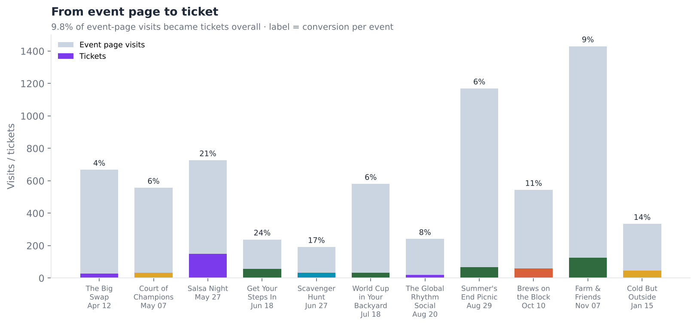
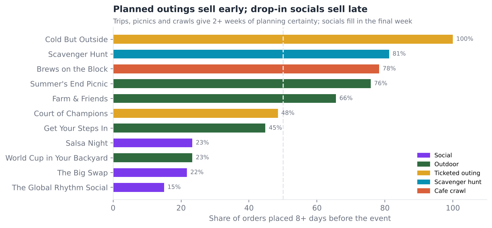
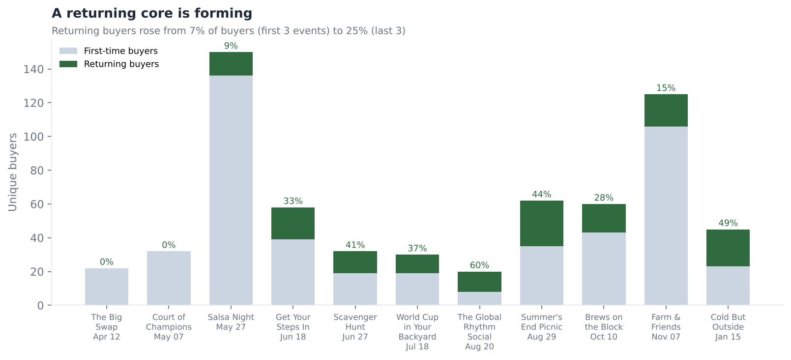
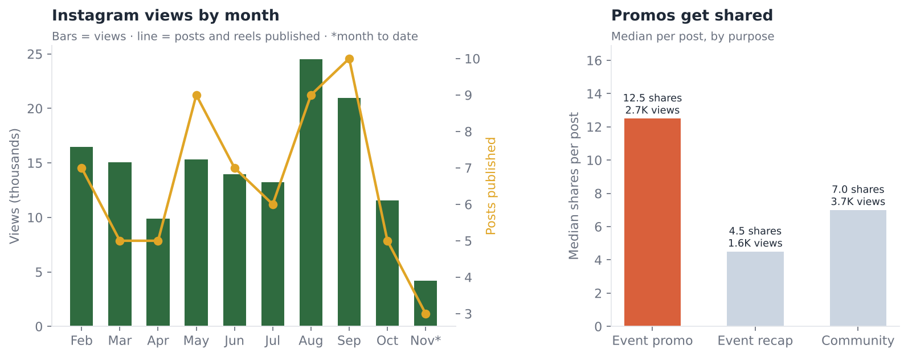

# Outside Collective Performance

**Running a community events business with data: how people discover events, convert to tickets, show up, and come back, and what that means for strategy, operations and growth.**

### ▶ [Open the live dashboard](https://k-b-c-04.github.io/outside-collective-dashboard/)

**Outside Collective** is a Washington DC social events community I organize: cafe crawls, scavenger hunts, picnics, dance socials, sports outings and weekend trips. Since April 2026 it has run **10 events plus a January trip on sale**, sold **652 tickets** to **498 people**, and drawn **145K views** across 66 Instagram posts. This repo is the operating dashboard I use to run it, and the business decisions it has led to.

> **About the data.** Ticket, attendance, conversion and Instagram figures are actual totals from Posh (ticketing) and Instagram. **Revenue, price and fee figures are illustrative**, not Outside Collective's financials. The repo holds **no personal data**: no attendee or follower names, emails, handles or order details, only per-event and per-post totals. See [`DATA_NOTES.md`](DATA_NOTES.md).



---

## Business skills in practice

| Skill | What it looks like here |
|---|---|
| **Strategy** | Designing an event portfolio: free socials that bring in new people and convert page visits at about twice the rate of paid events, and planned paid outings that sell weeks ahead and carry the revenue. |
| **Operations & logistics** | Capacity planning across venues in DC, Maryland and Pennsylvania. Events with a cap filled **88%** on average and **3 sold out**. Booking lead time shows when headcount becomes reliable enough to commit to venues, food and transport. |
| **Leads & conversion** | Running the full funnel from Instagram views to event page visits, tickets and check-ins. **9.8%** of event page visits become tickets, and the conversion rate varies from 4% to 24% by event. |
| **Customer retention** | Tracking first-time vs returning buyers per event: returning buyers grew from **7%** of buyers at the first three events to **25%** at the last three, with **154** repeat purchases so far. |
| **Marketing & content strategy** | Measuring which posts travel: event promos get about **3× the shares** of recaps, and carousels and images get more views per post than reels, even though reels are most of the output. |
| **Channel strategy** | Posh marketplace discovery delivers **22%** of tickets overall and nearly a third for free events, so free events double as the main source of new attendees. |
| **Unit economics** | Pricing and revenue per event and per ticket, refunds (under 1% of orders), and how a single planned trip can outweigh several smaller paid events. Figures in the repo are illustrative. |
| **Data & measurement** | Defining the metrics, pulling them from two platforms, documenting every gap honestly (check-ins weren't scanned at every event; Instagram traffic can't yet be attributed), and turning them into next steps. |

## What the data says to do next

| Area | Finding | Next step |
|---|---|---|
| **Operations** | Tickets were scanned at only **4 of 10** events. Where they were, **44%** of ticket holders were checked in (range 20–63%). | Scan at every event and set RSVP caps from the measured show rate. |
| **Conversion** | Posh sees Instagram traffic only as "direct", so Instagram's contribution to sales is invisible. | Use a separate Posh tracking link for the bio, stories and each promo post. |
| **Strategy** | Trips, picnics, crawls and the scavenger hunt sell early: **66–100%** of orders arrive 8+ days out, versus **15–23%** for drop-in socials. The January trip is **92% sold** with 7 weeks to go. | Alternate free socials (acquisition) with one planned outing per month (revenue and planning certainty). |
| **Retention** | A returning core is forming: returning buyers made up **15–49%** of each event's buyers since August. | Offer early access to planned outings for repeat attendees. |







## The dashboard

| View | What it shows |
|---|---|
| **Overview** | Headline KPIs, the four next steps, tickets by event, and the lead-to-attendance funnel |
| **Events & operations** | Booking lead time, sell-through and check-in rates, and an event log; filter by event type and paid vs free |
| **Conversion & retention** | Page-visit-to-ticket conversion per event, first-time vs returning buyers, ticket sources, and returning share over time |
| **Content** | Instagram views and posting cadence by month, median performance by format and purpose, and top posts; filter by format and purpose |

## Repository contents

| Path | What it is |
|---|---|
| [`docs/index.html`](docs/index.html) | The dashboard: one self-contained page (HTML, CSS, JavaScript and Chart.js), served by GitHub Pages |
| [`analysis/analyze.py`](analysis/analyze.py) | Joins the ticketing and content data, computes the metrics, renders the charts and exports the dashboard data |
| [`data/oc_events.csv`](data/oc_events.csv) | One row per event: tickets, capacity, check-ins, page visits, booking lead time, first-time vs returning buyers (financial columns illustrative) |
| [`data/oc_event_sources.csv`](data/oc_event_sources.csv) | Tickets by sales source per event |
| [`data/oc_instagram_posts.csv`](data/oc_instagram_posts.csv) | One row per post or reel: format, purpose, views, likes, comments, shares |
| [`data/oc_instagram_monthly.csv`](data/oc_instagram_monthly.csv) | Instagram totals by month |
| [`DATA_NOTES.md`](DATA_NOTES.md) | Sources, definitions and known gaps |

**Run it locally**
```bash
pip install pandas matplotlib numpy
python analysis/analyze.py           # prints the metrics, writes charts and docs/data.json
python -m http.server -d docs 8000   # open http://localhost:8000
```

---

*Part of [Kamsi's portfolio](https://github.com/K-B-C-04).*
